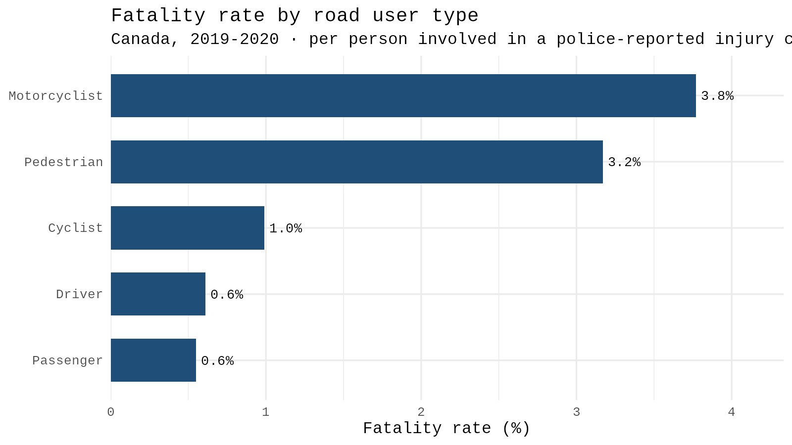
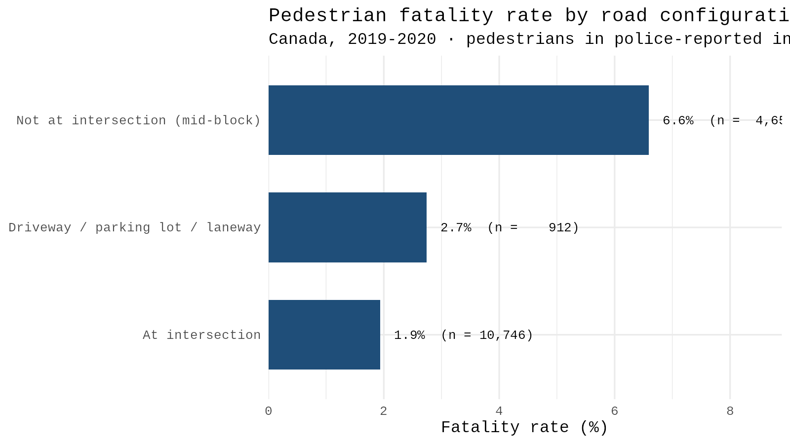

# Who gets hurt: injury severity in 471,046 Canadian collision records

I wanted to know who gets hurt in a police-reported collision, and how much that depends on whether you were inside a vehicle.

The data is Transport Canada's [National Collision Database (NCDB)](https://open.canada.ca/data/en/dataset/1eb9eba7-71d1-4b30-9fb1-30cbdab7e63a) for 2019 and 2020: 471,046 person-level records, loaded into SQLite from the raw government files. SQL does the aggregation. R does the analysis and the charts.

Status: the road user comparison and the pedestrian breakdown are done. I'm working on a logistic regression on injury odds next, with a held-out prediction check.

---

## Finding 1: being outside the vehicle matters most



Per person involved in a police-reported injury collision, Canada, 2019 to 2020:

| Road user | Persons | Fatality % | × occupant fatality rate | Injured or killed % |
|---|---|---|---|---|
| Motorcyclist | 11,383 | 3.77 | 6.3× | 94.96 |
| Pedestrian | 18,950 | 3.17 | 5.3× | 97.86 |
| Cyclist | 8,989 | 0.99 | 1.7× | 96.25 |
| Driver | 280,893 | 0.61 | 1.0× | 53.45 |
| Passenger | 102,267 | 0.55 | 0.9× | 53.42 |

The occupant fatality rate is drivers and passengers combined, weighted by how many people are in each group.

Motorcyclists die at **6.3 times** the occupant rate and pedestrians at **5.3 times**.

I think the last column says more than the fatality rate does. Between 95 and 98 percent of people outside a vehicle were injured or killed, compared with 53 percent of people inside one. About half of everyone in a car walks away from a reported collision without an injury. Almost nobody on foot or on a bike does.

Cyclists surprised me. They get injured about as often as pedestrians and motorcyclists (96 percent), but their fatality rate is around 1 percent instead of 3 to 4.

Query: [`sql/01_road_user.sql`](sql/01_road_user.sql)

## Finding 2: pedestrians hit away from an intersection are 3.4 times as likely to die



| Road configuration (`C_RCFG`) | Pedestrians | Fatality % |
|---|---|---|
| At an intersection of public roads (02) | 10,746 | 1.94 |
| Not at an intersection, "mid-block" (01) | 4,656 | 6.59 |
| Driveway, parking lot entrance or laneway (03) | 912 | 2.74 |

Most pedestrian injuries happen at intersections. A pedestrian hit between intersections is much more likely to die, though: 6.59 percent, about **3.4 times** the rate at an intersection.

The data can't tell me why. The NCDB has no vehicle speed field. Cars probably move faster away from intersections, but that's my guess, not something this dataset shows.

I left configurations with fewer than 100 pedestrians off the chart (railroad crossings, bridges, tunnels, ramps and traffic circles, with 4 to 25 people each), because a rate on that few people doesn't mean much. 2,549 pedestrians have no road configuration recorded, so they're excluded.

I also checked whether the pedestrian coding is consistent. Only 1 pedestrian record has position or vehicle codes (`P_PSN`, `V_ID`) that contradict the pedestrian flag.

Query: [`sql/02_pedestrians.sql`](sql/02_pedestrians.sql)

## Finding 3: the outcome filter drops pedestrians far more than anyone else

The rates above only use rows where injury severity was recorded (`P_ISEV` in 1, 2, 3). That filter doesn't hit every group equally:

| Road user | Before filter | After | Dropped |
|---|---|---|---|
| Pedestrian | 22,709 | 18,950 | 16.6% |
| Driver | 296,152 | 280,893 | 5.2% |
| Motorcyclist | 11,658 | 11,383 | 2.4% |
| Cyclist | 9,049 | 8,989 | 0.7% |
| Passenger | 102,496 | 102,267 | 0.2% |

Pedestrians lose 16.6 percent of their rows to unknown severity, about 80 times the passenger rate. So the pedestrian numbers in Finding 1 come from a more filtered group than everyone else's. If the missing pedestrian outcomes lean one way, the comparison is biased, and nothing in this dataset tells me which way.

I can't fix this with the data I have, so I'm stating it here instead.

---

## Decisions

These are the choices that could change a number, and why I made them.

- Outcome filter: only `P_ISEV` 1, 2 or 3 (no injury, injury, fatality). Unknown severity is excluded and counted in Finding 3, not treated as "no injury".
- Road user: 28,982 rows (6.2 percent of the file) have no `P_USER` recorded. They're coded `U` in the raw data, become `NA` during cleaning, and are left out of every rate.
- Comparison baseline: the ratios in Finding 1 compare against all vehicle occupants, not drivers alone.
- Small groups: anything with fewer than 100 people shows up in the tables but not on the charts.
- Restraint use (regression only): `P_SAFE` 02 ("safety device used") counts as used and 01 as not used. I drop helmets (09, 11), reflective clothing (10), other devices (12) and "no device equipped" (13) instead of lumping them in with "did not use one". A helmet isn't a seatbelt, and a seat with no belt isn't a choice the person made.
- Regression population: drivers and passengers only, so "restraint" means the same thing in every row.
- Age bands: `P_AGE` is cut at 15, 24, 34, 44, 54 and 64.
- Unknown codes: `Q`, `QQ`, `U`, `UU` and `X` in the raw files become `NA`, never zero.
- The two years weren't coded the same way. I found this while cleaning. Since I pool the years and compare them, leaving it alone would have given wrong numbers that still looked fine. The fix is in [`notebooks/01_load_and_clean.ipynb`](notebooks/01_load_and_clean.ipynb).

## Limitations

- This is Canada, not BC. The NCDB has no province or location field, so I can't narrow it down geographically.
- There's no exposure data. The database records collisions, not trips, so nobody counts the people who travelled that day and got home fine. That means this shows who gets hurt once a serious collision has already happened. It doesn't say what causes collisions, or whether any road user is more likely to be in one.
- The population is already filtered. The NCDB only holds police-reported collisions with an injury or death, so minor crashes are mostly missing and every rate here assumes the crash was serious enough to report.
- There's no speed data, so any explanation that depends on speed (like the intersection result) is a guess I can't test.
- Weather is recorded per collision, so everyone in the same crash has the same value. Any weather effect in the model rests on far fewer independent observations than the row count suggests.

## Next: the regression

I'm fitting a logistic regression on the odds of injury for vehicle occupants, holding age, restraint use, weather and year fixed.

With roughly 400,000 rows, almost every p-value will come out near zero. That's because of the sample size, not because every effect is real. So I'll report odds ratios with 95 percent confidence intervals, and if an interval crosses 1.0, I'll say the effect can't be told apart from no effect.

After that I'll fit the same model on 80 percent of the data, test it on the other 20 percent, and always report its accuracy next to the baseline of just guessing the most common outcome.

---

## Repository

```
data/        NCD_2019.csv, NCD_2020.csv
sql/         collisions.db, 01_road_user.sql, 02_pedestrians.sql
notebooks/   01_load_and_clean.ipynb, 02_analysis.ipynb
figures/     road_user_fatality.png, pedestrian_road_config.png
```

Every query lives in a `.sql` file, and the notebook runs it from that file. That way the repo always matches what actually produced the numbers.

Tools: SQLite, R (DBI, RSQLite, dplyr, ggplot2, broom), Google Colab.
